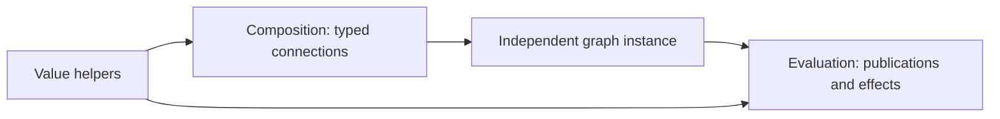

# Temporal model

Status: agreed publication, handler, state/cache, and capability baseline.
The alarm and the run-wide keyed store are agreed.

## Grammar

```ebnf
state_decl = "state", IDENTIFIER, [ ":", value_type ], "=", expression ;
cache_decl = "cache", IDENTIFIER, [ ":", value_type ], "=", expression ;
inject_decl = "inject", IDENTIFIER, { ",", IDENTIFIER }, [ "," ] ;
lifecycle_block = ( "start" | "stop" ), block ;
when_statement = "when", [ expression ], block ;
```

CTRL-9 places the opening brace of a `when` body.

## Rules



- **TIME-1.** A temporal endpoint has validity, modification at the current
  evaluation time, retained data, and publication-delta observations. Silence
  is not a value. An equal publication may still be a new tick. A payload read
  requires admission/readability; metadata may observe an invalid endpoint.
- **TIME-2.** Composition describes a typed graph without reading live
  payloads. Evaluation propagates changes in dependency order, at most once
  per node per cycle. A node's rank is one more than the greatest rank of
  the nodes it depends on, and the least where it depends on none. A cycle
  evaluates nodes in rank order, and the order of two nodes of one rank is
  undefined. Input activity controls notification; required validity
  controls admission. Mutation of output and mutation of configuration are
  different effects.
- **TIME-3.** Function-level `when` conditions are checked in source order.
  The first satisfied condition runs its body first. If that body completes
  without returning, checking continues with the next condition. A `return`
  exits the function's current evaluation; later handlers are not reached
  (FN-7). In a `when` header, `modified()` subscribes to all
  temporal inputs; `modified(a, b)` subscribes to both named inputs, and
  similarly for more inputs. A notification from any subscribed input can
  wake the handler, and one from any other cannot. `modified([])` subscribes
  to no input: the node's scheduler or alarm is then what wakes the handler.
  A wake by the scheduler or alarm wakes the handlers that subscribe to no
  input and those whose header has `scheduled()` (TIME-9) alone or as a
  top-level conjunct.
  Where the node injects neither, or its `start` does not use the one it
  injects, nothing wakes it: the node is dormant, and the selector is warned
  of (`node.no_activation`, ERR-10). Any use in `start` counts; what a
  function given the capability does with it is not followed. A node that is
  dormant by design acknowledges the warning. `valid()`
  requires all temporal inputs to be valid;
  `valid(a, b)` requires both named inputs, and similarly for more inputs.
  Omitting either selector uses the same default as its zero-argument form.
  `valid([])` requires no inputs to be valid. A selector sets subscription or admission
  when it stands alone in the header or appears as a top-level conjunct.
  Selectors under negation or disjunction leave the default in place.
  A `when` nested in another block is rejected.
- **TIME-4.** Aggregate subscriptions cover every handler. Node-wide validity
  includes only requirements common to executable handlers; other guards stay
  per-handler. A payload read under manual admission must be dominated by a
  successful guard. A guard is a test of `valid(input)`, on the input by its
  name, that holds where the read stands: in the branch it holds for, in the
  right operand of the `&&` it guards, and after a branch that returns, the
  paths a null test is followed along (ERR-12). A saved bool proves nothing.
  `valid` and `all_valid` retain distinct child-validity rules.
- **TIME-5.** State/cache/inject declarations precede executable hooks. At most
  one start and one stop are admitted. State initializers cannot read current
  temporal inputs. `start` reads no temporal input and gives none to an
  endpoint operation: it runs before any has a value. `stop` reads a
  temporal input under manual admission, as a `when` under `valid([])`
  does: no header stands over it, so each payload read is dominated by a
  guard (TIME-4). Start follows initialization; stop performs semantic
  finalization. Runtime ownership handles destruction.
- **TIME-6.** State is persistent, recordable node history. Initializers do not
  overwrite restored state. Cache is reconstructible node-local value data,
  initialized on every start using available restored state. Checkpoint support
  is an additional runtime facility, not a promise that every run persists.
  Arbitrary opaque resources are not ordinary state/cache values.
- **TIME-7.** A runtime return publishes to its result. `inject out` exposes that
  same result for reads, assignment, and admitted piecewise mutation. It adds
  no second output and is rejected for outputless functions. `out` is read
  in a `when` and in `stop`, and written only in a `when`: `start` neither
  reads nor writes it, and a `return` with a value stands in neither `start`
  nor `stop`. A node that publishes when the graph starts schedules itself
  in `start` and writes in its first scheduled evaluation. No write means no
  tick; whole-output invalidation is explicit and distinct from silence. In
  a hook, `return value` and `out = value` take a complete value of the
  result's type T, published whole, or a `delta<T>` (TYPE-16), published as
  that change; so does a source's `yield` (SOURCE-1). The place expects T
  (EXPR-5), so a value that is a T is published whole: `return []` for a
  `list<i64>` result publishes the empty list, and `return null` for an
  `i64?` result a null, as `return delta<i64?>()` does. A value that is no
  T and is a `delta<T>` is published as that change; a binding annotated
  with that type gives one, `let change: delta<list<i64>> = []`. Where T
  publishes whole, as a scalar does, `delta<T>` is T and the two are one.
  A `return` with no value publishes nothing (FN-7). A result of
  `atomic<V>` takes a V.
- **TIME-8.** The injectables are `out`, `logger`, `clock`, `scheduler`,
  `alarm`, and `global_state`; `inject` names no other. `out` is the node's
  result (TIME-7). `inject` binds each of the others to a local of its
  capability's type, which core declares and names as the capability with a
  capital: `Logger`, `Clock`, `Scheduler`, `Alarm`, `GlobalState`. A
  capability type is written only as the type of a parameter of a `const fn`
  or of a native value function. A capability is used within the node that
  injects it and is not retained: it is not the value of a `state` or a
  `cache`, an entry of a tuple, list, set, dictionary, or struct, what a
  function returns, what a node publishes, or a capture of an anonymous
  function (FN-14). Binding one to a `let` and giving one to a parameter of
  its type are uses. A parameter written as a generic parameter or `any`
  takes none, and no generic argument is a capability type. Its properties
  are read-only, `clock.evaluation_time`,
  and its operations are functions that take it first,
  `schedule(scheduler, delay)`, with no method-call aliases. A node injects
  `alarm` or `scheduler`, not both.
- **TIME-9.** `endpoint<T>` is the type of the endpoint of a temporal value
  of T, for a function that takes the endpoint and not its payload
  (TYPE-12). The operations on an endpoint are core's native value functions
  with such a parameter: `valid`, `modified`, `delta_value`,
  `last_modified`, `invalidate`, `activate`, and `passivate`. A call gives
  an `endpoint<T>` parameter a temporal input of the enclosing node by its
  name, or `out`, and nothing else; the endpoint is not retained, as a
  capability is not (TIME-8). Every other function takes the payload: a
  `const fn` is given the value, and a temporal `fn` is not called in a
  hook. `activate(input)` and `passivate(input)` operate on direct temporal
  inputs. Core's endpoint contract says what each returns. `scheduled()` is
  the handler selector for a wake by the node's scheduler or alarm. In a
  node that injects `scheduler` it is the scheduler's `is_scheduled_now`
  (core's capability contract): a wake asked of the scheduler is due in this
  evaluation, whether or not a temporal input has ticked. In a node that
  injects `alarm` it holds where the node is evaluated and no temporal input
  has ticked. A node that injects neither rejects it (`inject.no_scheduler`).
  `modified` and `valid` are selectors in a `when` header (TIME-3): there
  they are forms of the language, which set subscription and admission.
  None of these names is shadowed (UNIT-12). A value function injects no
  capability and has no output or schedule of its own (FN-9).
- **TIME-10.** A reference ticks on changed designation, not every target tick.
  Ordinary followers observe the selected target; saved routes do not extend
  an expired child lifetime. Structural child membership, child validity, and
  child publications are separate observations supplied by core.

Accepted illustration, complete module:

```hgl
module examples.handlers

fn manual_forward(value: i64) -> i64 {
    inject out
    when modified() && valid([]) {
        if valid(value) { return value }
        invalidate(out)
    }
}

fn guarded_forward(value: i64) -> i64 {
    inject out
    when modified() && valid(value) { return value }
    when modified() && valid([]) { invalidate(out) }
}

fn last_seen(value: i64) -> i64 {
    state last: i64 = 0
    when { return value }
    stop {
        if valid(value) { last = value }
    }
}
```

`modified()` subscribes to input notifications. `valid([])` lets the body check
validity itself. The two forms have the same observations: a valid input
publishes its value and an invalid input invalidates the output. In the guarded
form, the first body's return prevents the invalidation clause from running.
Deliberate rejections: replacing `if valid(value) { return value }` in
`manual_forward` with `return value + 1`, an unguarded payload read under
manual admission (`payload.unguarded`);
`valid(value + 1)`, which names no input (`endpoint.argument`); a `let`
beside the `when` (`node.statement`); and a `start` that reads or writes
`out` (`out.lifecycle`). In `last_seen` the `stop` reads `value` under its
guard (TIME-5); `stop { last = value }` is an unguarded read
(`payload.unguarded`), and `start { last = value }` reads an input where
none has a value (`input.lifecycle`).
Conformance planned.

Accepted illustration, complete module, a node that publishes when the graph
starts (TIME-7):

```hgl
module examples.first_tick

fn counted(value: i64) -> i64 {
    state seen: i64 = 0
    inject scheduler
    start { schedule(scheduler, 0s) }
    when scheduled() && valid([]) { return seen }
    when modified() {
        seen += 1
        return seen
    }
}
```

`start` schedules the node and writes nothing. The first evaluation is the
scheduled one, which publishes 0: the graph is connected by then, and the
publication is a tick like any other. `valid([])` admits that handler before
`value` has published; it reads no input, so it needs no guard.
Conformance planned.

Accepted illustration, complete module, a wake that lands with an input's
tick (TIME-9):

```hgl
module examples.sampled

fn sampled(price: f64, const every: duration = 1s) -> f64 {
    state last: f64 = 0.0
    inject scheduler
    start { schedule(scheduler, every) }
    when modified(price) && valid(price) {
        last = price
    }
    when scheduled() {
        schedule(scheduler, every)
        return last
    }
}
```

`price` publishes 10.0 at 0.4s and 11.0 at 1s, where the first wake is due.

| Evaluation | `last` | `scheduled()` | Published |
| --- | --- | --- | --- |
| 0.4s | 10.0 | False | Nothing |
| 1s | 11.0 | True: the wake is due, and `price` has ticked too | 11.0, and the next wake is asked for |
| 2s | 11.0 | True | 11.0, and the next wake is asked for |

The wake at 2s does not run the first handler, which `price` wakes.

With `inject alarm` in place of `inject scheduler`, `scheduled()` is false
at 1s, where `price` has ticked: nothing is published, and no further wake is
asked for. Deliberate rejection: `when scheduled()` in a node that injects
neither (`inject.no_scheduler`). Conformance planned.

Accepted illustration, complete module, the selectors of a `when` header
(TIME-3):

```hgl
module examples.selectors

fn default_sum(a: f64, b: f64) -> f64 {
    when { return a + b }
}

fn explicit_sum(a: f64, b: f64) -> f64 {
    when modified(a, b) && valid(a, b) { return a + b }
}

fn on_a(a: f64, b: f64) -> f64 {
    when modified(a) { return a + b }
}

fn while_a_valid(a: f64, b: f64) -> f64 {
    when valid(a) { return a }
}

fn sum_or_zero(a: f64, b: f64) -> f64 {
    when valid([]) {
        if valid(a) && valid(b) { return a + b }
        return 0.0
    }
}

fn sampled(a: f64, const every: duration = 1s) -> f64 {
    inject scheduler
    start { schedule(scheduler, every) }
    when modified([]) && valid([]) {
        schedule(scheduler, every)
        if valid(a) { return a }
    }
}

@suppress_warning("node.no_activation")
fn null_sink(a: f64) {
    when modified([]) { }
}
```

With `a` publishing 1.0, nothing, 3.0 and `b` publishing nothing, 10.0, 20.0
over three cycles, each input keeping its value while it is silent:

| Function | Header | Publishes | Why |
| --- | --- | --- | --- |
| `default_sum`, `explicit_sum` | None; `modified(a, b) && valid(a, b)` | Nothing, 11.0, 23.0 | The two say the same: any input wakes it, and both are valid from the second cycle |
| `on_a` | `modified(a)` | Nothing, nothing, 23.0 | `b` cannot wake it; validity is the default, both inputs |
| `while_a_valid` | `valid(a)` | 1.0, 1.0, 3.0 | Subscription is the default, so `b` wakes it while `a` holds 1.0 |
| `sum_or_zero` | `valid([])` | 0.0, 11.0, 23.0 | Nothing is required of the inputs, and the body guards each read |

`sampled` subscribes to no input. Its scheduler, which `start` sets going,
is all that wakes it, and every wake asks for the next: it requires no
input to be valid, so a wake before `a` has published still does. Once a
second it publishes the value `a` holds, whether or not `a` has ticked, and
nothing while `a` is invalid. `null_sink` takes its input and does nothing
with it: no input wakes it and it has no scheduler, so it is dormant, which
is what it is for, and it acknowledges the warning. Without the annotation
it is warned of (`node.no_activation`) and still accepted, as `sampled`
would be with no `start`. Deliberate rejections: in `while_a_valid`,
`return a + b`, a read of `b` that neither the header requires nor a guard
proves (`payload.unguarded`); and `modified([a, b])` and `valid([a, b])`,
where the inputs are named as arguments. Conformance planned.

## Alarm and global state

`alarm` is a scheduler that tracks nothing: a node asks it for a wake, and
that wake is neither queried, moved, nor cancelled. It keeps the earliest
wake asked for and is best effort. Any node injects it, with temporal inputs
or with none, in place of `scheduler`. An alarm keeps no record of a wake, so
its wake is told from the inputs (TIME-9): an evaluation in which a temporal
input has ticked runs the handlers that tick wakes, and one in which none
has ticked is the alarm's, and runs the handlers a wake does (TIME-3). A
wake that lands with an input's tick is not told from the tick. In a node
with no temporal input every handler subscribes to none, so a `when` with no
selector handles the wake as `when scheduled()` does. The
[generator form](control-flow-and-sources.md) owns its own wake mechanism.

`global_state` is a run-wide typed store with const string keys. It is empty
when the graph is built, and nothing outside the program puts a value in
it: an entry is configured by its const arguments. All uses of a key bind
the same exact ordinary type. Binding alone does not initialize a value. Get
of an absent entry fails; a write preserves the type. Writable borrows are
hook-scoped; retained results own independent values. Storage access adds no
activation dependency or temporal endpoint type, and so no rank (TIME-2): a
`put` is seen by what is evaluated after it, and what a node sees of a `put`
by a node of its own rank in the same cycle is undefined. A program that
shares a key between two such nodes takes that order on itself. The key
`"run.output"` is
the run's own, where it keeps its output: a program that names it rejects
(`store.reserved_key`).

Accepted illustration, complete module:

```hgl
module examples.capabilities

const fn stamped(clock: Clock, value: f64) -> tuple<datetime, f64> =>
    (clock.evaluation_time, value)

fn stamp(value: f64) -> tuple<datetime, f64> {
    inject clock
    when { return stamped(clock, value) }
}

fn poll(const every: duration = 1s) -> i64 {
    inject alarm, global_state
    start {
        put(global_state, "count", 0)
        schedule(alarm, every)
    }
    when scheduled() {
        schedule(alarm, every)
        let count = get<i64>(global_state, "count") + 1
        put(global_state, "count", count)
        return count
    }
}
```

`stamp` gives its clock to `stamped`, whose parameter is of the clock's type;
`stamped` reads one of its properties. `poll` has no temporal input: its
alarm wakes it. Its `start` puts the count in the global state, which holds
nothing until a program puts it there, and each wake asks for the next, adds
one to the count held there, and publishes it. Deliberate rejections:
`put(global_state, "run.output", 0)`, a key that is the run's own;
`state kept: Clock`, and `let pair = (clock, value)`, a capability
retained; `stamped(logger, value)`,
a `Logger` where a `Clock` is taken; `boxed(clock)`, with
`const fn boxed<T>(value: T) -> list<T>`, a capability given to a generic
parameter; `inject alarm, scheduler` in one node; and
`clock.evaluation_time = value`, a property assigned. Conformance planned.

## Core boundary

Core defines clock/scheduler interfaces, graph lifecycle, publication/delta
operations, storage, references, and child lifetime. This chapter fixes their
source interpretation and capability phases without prescribing a layout.
