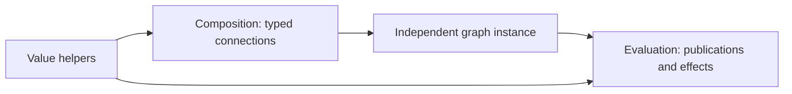

# Temporal model

Status: agreed publication, handler, state/cache, and capability baseline.
Source alarm and run-wide keyed storage extensions remain proposed.

## Grammar

```ebnf
state_decl = "state", IDENTIFIER, [ ":", value_type ], "=", expression ;
cache_decl = "cache", IDENTIFIER, [ ":", value_type ], "=", expression ;
inject_decl = "inject", IDENTIFIER, { ",", IDENTIFIER }, [ "," ] ;
lifecycle_block = ( "start" | "stop" ), block ;
when_statement = "when", [ expression ], block ;
```

CTRL-9 places the opening brace of a `when` body.

## Rules



- **TIME-1.** A temporal endpoint has validity, modification at the current
  evaluation time, retained data, and publication-delta observations. Silence
  is not a value. An equal publication may still be a new tick. A payload read
  requires admission/readability; metadata may observe an invalid endpoint.
- **TIME-2.** Composition describes a typed graph without reading live
  payloads. Evaluation propagates changes in dependency order, at most once
  per node per cycle. Input activity controls notification; required validity
  controls admission. Mutation of output and mutation of configuration are
  different effects.
- **TIME-3.** Function-level when handlers retain source order and evaluate
  independent conditions. A missing top-level modified selector subscribes to
  all temporal inputs; a missing validity selector requires all inputs valid.
  Explicit `modified()` subscribes to none and explicit `valid()` requires
  none valid. A selector hidden beneath negation/disjunction does not replace
  the default. A when nested in another block is rejected.
- **TIME-4.** Aggregate subscriptions cover every handler. Node-wide validity
  includes only requirements common to executable handlers; other guards stay
  per-handler. A payload read under manual admission must be dominated by a
  successful guard. `valid` and `all_valid` retain distinct child-validity rules.
- **TIME-5.** State/cache/inject declarations precede executable hooks. At most
  one start and one stop are admitted. State initializers cannot read current
  temporal inputs. Start follows initialization; stop performs semantic
  finalization. Runtime ownership handles destruction.
- **TIME-6.** State is persistent, recordable node history. Initializers do not
  overwrite restored state. Cache is reconstructible node-local value data,
  initialized on every start using available restored state. Checkpoint support
  is an additional runtime facility, not a promise that every run persists.
  Arbitrary opaque resources are not ordinary state/cache values.
- **TIME-7.** A runtime return publishes to its result. `inject out` exposes that
  same result for reads, assignment, and admitted piecewise mutation. It adds
  no second output and is rejected for outputless functions. Output access is
  admitted during evaluation, not implicitly in start/stop. No write means no
  tick; whole-output invalidation is explicit and distinct from silence.
- **TIME-8.** Approved injectables are capabilities, not first-class payloads.
  Clock properties are read-only, including `clock.evaluation_time`. Operations
  use direct receiver-first forms such as `schedule(scheduler, delay)` and
  `info(logger, value)`, with no method-call aliases. Arbitrary helpers cannot
  receive a capability as ordinary data.
- **TIME-9.** `scheduled()` is the scheduler handler selector. `activate(input)`
  and `passivate(input)` operate on direct temporal inputs. These reserved
  intrinsics cannot be shadowed. Value helpers inherit admitted capabilities;
  they cannot acquire their own temporal output or scheduling lifetime.
- **TIME-10.** A reference ticks on changed designation, not every target tick.
  Ordinary followers observe the selected target; saved routes do not extend
  an expired child lifetime. Structural child membership, child validity, and
  child publications are separate observations supplied by core.

Accepted illustration, complete module:

```hgl
module examples.handlers

fn manual_forward(value: i64) -> i64 {
    inject out
    when valid() {
        if valid(value) { return value }
        invalidate(out)
    }
}
```

Input modification still activates this handler; explicit empty validity
permits its internal validity test. Invalid input invalidates the output.
Deliberate rejection: an unguarded payload read under manual admission.
Conformance planned.

## Proposed source and storage capabilities

`alarm` is source-only, exclusive with scheduler, and keeps the earliest
requested wake without recovery/query state. A plain when handles its wake.
The [generator form](control-flow-and-sources.md) owns its own wake mechanism.

`global_state` is a run-wide typed store with const string keys prepared before
root start. All uses/seeds bind the same exact ordinary type. Binding alone
does not initialize a value. Get of an absent entry fails; set preserves type.
Writable borrows are hook-scoped; retained results own independent values.
Storage access adds no activation dependency or temporal endpoint type.

## Core boundary

Core defines clock/scheduler interfaces, graph lifecycle, publication/delta
operations, storage, references, and child lifetime. This chapter fixes their
source interpretation and capability phases without prescribing a layout.
