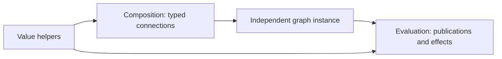

# Temporal model

Status: agreed publication, handler, state/cache, and capability baseline.
Source alarm and run-wide keyed storage extensions remain proposed.

## Grammar

```ebnf
state_decl = "state", IDENTIFIER, [ ":", value_type ], "=", expression ;
cache_decl = "cache", IDENTIFIER, [ ":", value_type ], "=", expression ;
inject_decl = "inject", IDENTIFIER, { ",", IDENTIFIER }, [ "," ] ;
lifecycle_block = ( "start" | "stop" ), block ;
when_statement = "when", [ expression ], block ;
```

CTRL-9 places the opening brace of a `when` body.

## Rules



- **TIME-1.** A temporal endpoint has validity, modification at the current
  evaluation time, retained data, and publication-delta observations. Silence
  is not a value. An equal publication may still be a new tick. A payload read
  requires admission/readability; metadata may observe an invalid endpoint.
- **TIME-2.** Composition describes a typed graph without reading live
  payloads. Evaluation propagates changes in dependency order, at most once
  per node per cycle. Input activity controls notification; required validity
  controls admission. Mutation of output and mutation of configuration are
  different effects.
- **TIME-3.** Function-level `when` handlers retain source order and evaluate
  independent conditions. In a `when` header, `modified()` subscribes to all
  temporal inputs. A notification from any subscribed input can wake the
  handler. `valid()` requires all temporal inputs to be valid. Omitting either
  selector uses the same default as its zero-argument form. `valid([])`
  requires no inputs to be valid. A selector sets subscription or admission
  when it stands alone in the header or appears as a top-level conjunct.
  Selectors under negation or disjunction leave the default in place.
  A `when` nested in another block is rejected.
- **TIME-4.** Aggregate subscriptions cover every handler. Node-wide validity
  includes only requirements common to executable handlers; other guards stay
  per-handler. A payload read under manual admission must be dominated by a
  successful guard. A guard is a test of `valid(input)`, on the input by its
  name, that holds where the read stands: in the branch it holds for, in the
  right operand of the `&&` it guards, and after a branch that returns, the
  paths a null test is followed along (ERR-12). A saved bool proves nothing.
  `valid` and `all_valid` retain distinct child-validity rules.
- **TIME-5.** State/cache/inject declarations precede executable hooks. At most
  one start and one stop are admitted. State initializers cannot read current
  temporal inputs. Start follows initialization; stop performs semantic
  finalization. Runtime ownership handles destruction.
- **TIME-6.** State is persistent, recordable node history. Initializers do not
  overwrite restored state. Cache is reconstructible node-local value data,
  initialized on every start using available restored state. Checkpoint support
  is an additional runtime facility, not a promise that every run persists.
  Arbitrary opaque resources are not ordinary state/cache values.
- **TIME-7.** A runtime return publishes to its result. `inject out` exposes that
  same result for reads, assignment, and admitted piecewise mutation. It adds
  no second output and is rejected for outputless functions. `out` is read
  in a `when` and in `stop`, and written only in a `when`: `start` neither
  reads nor writes it, and a `return` with a value stands in neither `start`
  nor `stop`. A node that publishes when the graph starts schedules itself
  in `start` and writes in its first scheduled evaluation. No write means no
  tick; whole-output invalidation is explicit and distinct from silence.
- **TIME-8.** The injectables are `out`, `logger`, `clock`, and `scheduler`,
  and the proposed `alarm` and `global_state` below; `inject` names no other.
  They are capabilities, not first-class payloads. Clock properties are
  read-only, including `clock.evaluation_time`. Operations use direct
  receiver-first forms such as `schedule(scheduler, delay)` and
  `info(logger, value)`, with no method-call aliases. Arbitrary helpers cannot
  receive a capability as ordinary data.
- **TIME-9.** The operations on an endpoint are intrinsics of the language:
  `valid`, `modified`, `delta_value`, `last_modified`, `invalidate`,
  `scheduled`, `activate`, and `passivate`. No HGL declaration takes an
  endpoint: a `const fn` takes its payload, and a temporal `fn` is not called
  in a hook. `scheduled()` is the scheduler handler selector, and `modified`
  and `valid` are selectors in a `when` header (TIME-3). Elsewhere each takes
  a temporal input of the enclosing function by its name, or `out`;
  `activate(input)` and `passivate(input)` operate on direct temporal inputs.
  Core's endpoint contract says what each returns. These reserved
  intrinsics cannot be shadowed. Value helpers inherit admitted capabilities;
  they cannot acquire their own temporal output or scheduling lifetime.
- **TIME-10.** A reference ticks on changed designation, not every target tick.
  Ordinary followers observe the selected target; saved routes do not extend
  an expired child lifetime. Structural child membership, child validity, and
  child publications are separate observations supplied by core.

Accepted illustration, complete module:

```hgl
module examples.handlers

fn manual_forward(value: i64) -> i64 {
    inject out
    when modified() && valid([]) {
        if valid(value) { return value }
        invalidate(out)
    }
}
```

`modified()` subscribes to input notifications. `valid([])` lets the body check
validity itself. Invalid input invalidates the output.
Deliberate rejections: `return value + 1` in place of the guarded `return`, an
unguarded payload read under manual admission (`payload.unguarded`);
`valid(value + 1)`, which names no input (`endpoint.argument`); a `let`
beside the `when` (`node.statement`); and a `start` that reads or writes
`out` (`out.lifecycle`).
Conformance planned.

Accepted illustration, complete module, a node that publishes when the graph
starts (TIME-7):

```hgl
module examples.first_tick

fn counted(value: i64) -> i64 {
    state seen: i64 = 0
    inject scheduler
    start { schedule(scheduler, 0s) }
    when scheduled() && valid([]) { return seen }
    when modified() {
        seen += 1
        return seen
    }
}
```

`start` schedules the node and writes nothing. The first evaluation is the
scheduled one, which publishes 0: the graph is connected by then, and the
publication is a tick like any other. `valid([])` admits that handler before
`value` has published; it reads no input, so it needs no guard.
Conformance planned.

## Proposed source and storage capabilities

`alarm` is source-only, exclusive with scheduler, and keeps the earliest
requested wake without recovery/query state. A plain when handles its wake.
The [generator form](control-flow-and-sources.md) owns its own wake mechanism.

`global_state` is a run-wide typed store with const string keys prepared before
root start. All uses/seeds bind the same exact ordinary type. Binding alone
does not initialize a value. Get of an absent entry fails; set preserves type.
Writable borrows are hook-scoped; retained results own independent values.
Storage access adds no activation dependency or temporal endpoint type.

## Core boundary

Core defines clock/scheduler interfaces, graph lifecycle, publication/delta
operations, storage, references, and child lifetime. This chapter fixes their
source interpretation and capability phases without prescribing a layout.
