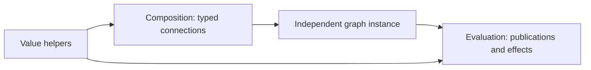

# Temporal model

Status: agreed publication, handler, state/cache, and capability baseline.
The alarm, the run-wide keyed store, collection validity with
`all_valid` (TIME-9), and the read of a collection's child and of a
collection whole (TIME-1) are agreed.

## Grammar

```ebnf
state_decl = "state", IDENTIFIER, [ ":", value_type ], "=", expression ;
cache_decl = "cache", IDENTIFIER, [ ":", value_type ], "=", expression ;
inject_decl = "inject", injected, { ",", injected }, [ "," ] ;
injected = IDENTIFIER, [ operator_configuration ] ;
lifecycle_block = ( "start" | "stop" ), block ;
when_statement = "when", [ expression ], block ;
```

CTRL-9 places the opening brace of a `when` body. `operator_configuration`
is in [expressions](expressions-and-bindings.md): `run_config` takes one,
and no other capability does (RUN-6).

## Rules



- **TIME-1.** A temporal endpoint has validity, modification at the current
  evaluation time, retained data, and publication-delta observations. Silence
  is not a value. An equal publication may still be a new tick; a delta
  that names no change, or a collection given whole that changes nothing,
  where the value is valid, is none (TIME-7). A
  payload read requires
  admission/readability; metadata may observe an invalid endpoint.
  A child of a collection (TIME-9), an element, a field or an entry, is an
  endpoint whether or not it is valid: `parts[1]` is given to `valid` and
  passed on as a connection while it is invalid. In a hook, a read of a
  child's value, or of its `delta_value`, requires that child's admission:
  `all_valid(parts)` admits every child, but for one read whole as a
  struct, a tuple or a fixed list (below), `valid(parts[1])` or
  `valid(quote.bid)` that one, and `valid(parts)` none (TIME-4). Where the
  read names its child when the program is compiled, at a constant index
  or a field, one that is not admitted rejects (`payload.unguarded`).
  Elsewhere, `parts[i]`, it is checked when it runs: a child that is not
  valid fails it (`value.unset_read`), or gives an `err` where its place
  takes a `result` (ERR-14). A read of a struct, a tuple or a fixed list
  whole, `return quote`, requires `all_valid` of it. So does one of a child
  that is a struct, a tuple or a fixed list: `return rows[0]`, for
  `rows: list<Quote, 2>`, requires `all_valid(rows[0])`, which
  `all_valid(rows)`, one level deep, does not give. In the value it reads,
  an optional child (TIME-9) that is not valid is null, and `valid` of that
  child tells it from a published null (TYPE-15). Where such a read is
  seen when the program is compiled and `all_valid` does not admit it, it
  rejects (`payload.unguarded`). Elsewhere, `rows[i]` read whole, it is
  checked when it runs: one that is not all valid, though a field or a
  position of it is valid, fails it (`value.unset_read`), or gives an
  `err` where its place takes a `result` and null where it takes a `T?`
  (ERR-14). A dictionary
  and an unsized list hold what they hold: a read of one whole requires
  its `valid` and no more. A dictionary read whole holds the entries that
  have a value: a key whose entry is not valid is left out. An entry that
  is valid and not all valid, a struct, a tuple or a fixed list with a
  part that has no value, is not left out: the read of the dictionary
  whole fails as the read of that entry whole does (`value.unset_read`),
  or gives the form its place takes (ERR-14). A position of an
  unsized list that holds no value, a gap or one removed (TYPE-16), reads
  in the whole value as the table below has it for the element type: as
  that type's value for "not set" where it has one. Where it has none the
  read fails (`value.unset_read`), or gives an `err` where its place takes
  a `result`, as a child's read checked when it runs does (ERR-14).
  `valid` of the position tells a value published there from none: a
  published NaN from a gap. So `updated: [3: 5.0]` on a `list<f64>` that
  holds `[1.0, 2.0]` leaves one read whole as `[1.0, 2.0, NaN, 5.0]`, and
  `updated: [3: 5]` on a `list<i64>` that holds `[1, 2]` leaves one whose
  whole read fails.

  | Element type | A position that holds no value reads as |
  | --- | --- |
  | `f64` | NaN |
  | `V?` | Null, as an optional child that is not valid is in any whole value (TYPE-15) |
  | Any other: `i64`, `bool`, `str`, `bytes`, a time scalar, a `tenor`, an enum, a struct, a collection | Nothing: the read fails |
- **TIME-2.** Composition describes a typed graph without reading live
  payloads. Evaluation propagates changes in dependency order, at most once
  per node per cycle. A node's rank is one more than the greatest rank of
  the nodes it depends on, and the least where it depends on none. A cycle
  evaluates nodes in rank order, and the order of two nodes of one rank is
  undefined. Input activity controls notification; required validity
  controls admission. Mutation of output and mutation of configuration are
  different effects.
- **TIME-3.** Function-level `when` conditions are checked in source order.
  The first satisfied condition runs its body first. If that body completes
  without returning, checking continues with the next condition. A `return`
  exits the function's current evaluation; later handlers are not reached
  (FN-7). A handler with no `modified` selector subscribes to every temporal
  input. On an input wake it checks its admission and condition without
  requiring a publication. An active input's transition to invalid wakes
  the node, so `when valid([])` can inspect the cleared endpoint.
  An explicit `modified()` also subscribes to every temporal input and
  requires at least one of them to have published this cycle.
  `modified(a, b)` subscribes to the named inputs and requires a publication
  on at least one of them. An input that counts as modified as its branch
  starts (CTRL-2), and a window of a duration that a value leaves
  (TYPE-11), each wake the node and satisfy these tests as a publication
  on it does. Invalidation of an active or passive input never
  satisfies a modification test for that input.
  Passivating an input removes it as a wake source. If a probe wakes the
  node in a cycle when passive `data` publishes, `when modified(data)`
  matches. `when modified(data) && is_active(data)` additionally requires
  the input to be active. The empty selection `modified([])` makes every
  temporal input passive for its handler: it subscribes to none, and
  selects a wake from the node's scheduler or alarm. In that handler's
  body `modified([])`, as a bool, is true, at a wake that lands with an
  input's tick included: what the header selected is taken as nothing
  modified. Elsewhere, in another body or under a negation or a
  disjunction, it is true in a cycle where no temporal input was modified,
  and so false where one counts as modified as its branch starts.
  A wake by the scheduler or alarm wakes the handlers that subscribe to no
  input and those whose header has `scheduled()` (TIME-9) alone or as a
  top-level conjunct. Such a wake alone runs no other handler: one with no
  `modified` selector subscribes to every temporal input, and is run by an
  input's wake.
  Where the node injects neither, or its `start` does not use the one it
  injects, nothing wakes it: the node is dormant, and the selector is warned
  of (`node.no_activation`, ERR-10). Any use in `start` counts; what a
  function given the capability does with it is not followed. A node that is
  dormant by design acknowledges the warning. `valid()`
  requires all temporal inputs to be valid;
  `valid(a, b)` requires both named inputs, and similarly for more inputs.
  Omitting the validity selector requires all temporal inputs to be valid,
  but for a `ref` parameter that holds no reference (TIME-10).
  A header that is `scheduled()` alone is the exception: it requires no
  input to be valid, as one that writes `valid([])` does, since it runs at
  the wake whatever the inputs hold.
  `valid([])` requires no inputs to be valid. A selector sets subscription or admission
  when it stands alone in the header or appears as a top-level conjunct.
  Selectors under negation or disjunction leave the default in place.
  A `when` nested in another block is rejected.
- **TIME-4.** Aggregate subscriptions cover every handler. Node-wide validity
  includes only requirements common to executable handlers; other guards stay
  per-handler. A payload read under manual admission must be dominated by a
  successful guard. A guard is a test of `valid(input)` or of
  `modified(input)`, on the input by its
  name, that holds where the read stands: in the branch it holds for, in the
  right operand of the `&&` it guards, and after a branch that returns, the
  paths a null test is followed along (ERR-12). An input is not modified
  without being valid, so `modified` of it guards what `valid` of it does;
  `modified(a, b)`, which holds where either is, guards neither. A saved
  bool proves nothing.
  `valid` and `all_valid` retain distinct child-validity rules. A child's
  guard is a test of `all_valid` of its input, or of `valid` or `modified`
  of the child as the read names it, `valid(parts[1])` for `parts[1]`
  (TIME-1). The
  guard of a whole read of a struct, a tuple or a fixed list, a child
  among them, is a test of `all_valid` of what it reads, `all_valid(quote)`
  for `quote` and `all_valid(rows[0])` for `rows[0]`; of a
  dictionary or an unsized list, `valid` or `modified` of it, as of any
  input. A `when`
  header that has the test alone or as a top-level
  conjunct guards its body, `when all_valid(quote)` and
  `when modified(a) && valid([])`.
- **TIME-5.** State/cache/inject declarations precede executable hooks. At most
  one start and one stop are admitted. State initializers cannot read current
  temporal inputs. `start` reads no temporal input and gives none to an
  endpoint operation: it runs before any has a value. `stop` reads a
  temporal input under manual admission, as a `when` under `valid([])`
  does: no header stands over it, so each payload read is dominated by a
  guard (TIME-4). Every input is passive in `stop`, and `activate` and
  `passivate` there reject (`input.lifecycle`). Start follows
  initialization; stop performs semantic
  finalization. Runtime ownership handles destruction.
- **TIME-6.** State is persistent, recordable node history. Initializers do not
  overwrite restored state. Cache is reconstructible node-local value data,
  initialized on every start using available restored state. Checkpoint support
  is an additional runtime facility, not a promise that every run persists.
  Arbitrary opaque resources are not ordinary state/cache values.
- **TIME-7.** A runtime return publishes to its result. `inject out` exposes that
  same result for reads, assignment, and admitted piecewise mutation. It adds
  no second output and is rejected for outputless functions. `out` is read
  in a `when` and in `stop`, and written only in a `when`: `start` neither
  reads nor writes it, and a `return` with a value stands in neither `start`
  nor `stop`. A node that publishes when the graph starts schedules itself
  in `start` and writes in its first scheduled evaluation. No write means no
  tick; whole-output invalidation is explicit and distinct from silence. In
  a hook, `return value` and `out = value` take a complete value of the
  result's type T, published whole, or a `delta<T>` (TYPE-16), published as
  that change; so does a source's `yield` (SOURCE-1). The place expects T
  (EXPR-5), so a value that is a T is published whole: `return []` for a
  `list<i64>` result publishes the empty list, and `return null` for an
  `i64?` result a null, as `return delta<i64?>()` does. A value that is no
  T and is a `delta<T>` is published as that change,
  `return delta<list<i64>>(updated: [0: 5])`. Where T
  publishes whole, as a scalar does, `delta<T>` is T and the two are one.
  A delta that names no change, `delta<set<i64>>()`,
  `delta<dict<str, i64>>()` or `delta<list<i64>>()`, ticks only where it
  changes validity. For a never-published or wholly invalidated `list<V>`,
  dictionary or set, it publishes a valid empty value. A growing list whose
  last valid position loses its value keeps its size. While it still has
  positions, a delta that names no change leaves it invalid and wakes no
  subscriber. Writing `size_modified: 0` or publishing `[]` whole then
  truncates it and publishes a valid empty list. Where the collection is
  already valid the delta that names no change is no tick: it
  marks nothing `modified`, wakes no subscriber, and a trace records
  nothing for it (TST-5). A struct, a tuple and a `list<V, N>` are valid where a
  child is (TIME-9), and such a delta of one, `delta<Quote>()`, sets no
  child: it changes no validity, and is never a tick. A delta whose every
  entry is ignored, the removal of a key, a member or a position that is
  not held (TYPE-16), names no change too, and ticks only where it makes
  the value valid: `delta<set<i64>>(removed: [9])` on a valid set that
  does not hold 9 is no tick. A collection published whole is published
  as its change from what the result holds. Each entry of a dictionary and
  each position of a list that it gives is published, the same value again
  included, as an equal scalar is (TIME-1); a key, a member or a position
  that it leaves out is removed. Where that leaves nothing to publish, a
  set given the members it holds, or an empty list or dictionary given to
  a valid empty one, the value is unchanged, and it is no tick. Where a
  `list<V>`, a dictionary or a set is not valid, an empty one given whole
  makes it valid and ticks.
  A `return` with no value publishes nothing (FN-7). A result of
  `atomic<V>` takes a V. A result of `rolling_window<V, Max, Min>` takes a
  V, which arrives, and nothing else (TYPE-11): for a nullable V, `return
  null` is a null that arrives. One of a nullable V takes its delta as
  well, `delta<f64?>(value: 1.0)` or `delta<f64?>()`, as the
  arrival it holds, which is how a replay publishes a recorded one. A
  `ref` result takes no value: a `return` to it names an endpoint, which
  it designates, and `out` of it is as FN-16 gives it.
- **TIME-8.** The injectables are `out`, `logger`, `clock`, `scheduler`,
  `alarm`, `global_state`, and `run_config`; `inject` names no other. `out`
  is the node's
  result (TIME-7). `inject` binds each of the others to a local of its
  capability's type, which core declares and names as the capability with a
  capital: `Logger`, `Clock`, `Scheduler`, `Alarm`, `GlobalState`,
  `RunConfig`. A
  capability type is written only as the type of a parameter of a `const fn`
  or of a native value function. A capability is used within the node that
  injects it, or, for `global_state`, in the graph that injects it, where
  the graph is built (FN-9), and in the statements an application sets its
  run's store with (UNIT-14); `run_config` is an application's and an
  integration test's, and no function's (RUN-6). A capability is not
  retained: it is not the value of a `state` or a
  `cache`, an entry of a tuple, list, set, dictionary, or struct, what a
  function returns, what a node publishes, or a capture of an anonymous
  function (FN-14). Binding one to a `let` and giving one to a parameter of
  its type are uses. A parameter written as a generic parameter or `any`
  takes none, and no generic argument is a capability type. Its properties
  are read-only, `clock.evaluation_time`,
  and its operations are functions that take it first,
  `schedule(scheduler, delay)`, with no method-call aliases. A node injects
  `alarm` or `scheduler`, not both. What may be asked of the scheduler may
  be asked of the alarm alike, and each rule on a wake that follows holds
  of both. A wake asked for with a `duration` takes one more than zero, but
  in `start`, which takes zero too: `schedule(scheduler, 0s)` there asks
  for a wake at the start, the node's first evaluation. A duration that is
  not admitted, a negative one in `start` included, rejects where the compiler
  sees its value, a literal or a constant (UNIT-13), with
  `schedule.duration_bounds`, and elsewhere fails the call as the program
  runs, with `schedule.non_positive_duration`. A wake asked for at a `datetime`
  before the evaluation time is dropped: there is no wake, and no failure.
  Core's capability contract has the rest of what a wake is.
- **TIME-9.** `endpoint<T>` is the type of the endpoint of a temporal value
  of T, for a function that takes the endpoint and not its payload
  (TYPE-12). The operations on an endpoint are core's native value functions
  with such a parameter: `valid`, `all_valid`, `modified`, `delta_value`,
  `removed_value`, `last_modified`, `invalidate`, `is_active`, `activate`,
  and `passivate`. `removed_value` takes a window (TYPE-11), and nothing
  else.
  A collection is a type whose temporal form has children valid on their
  own (TYPE-9): a list, a tuple, a struct and a dictionary. `valid` of a
  collection is true where any element, field or entry is valid: work is
  possible on a partly populated value. It admits no child's read, and
  `all_valid` admits the read of the whole and of every child, but for a
  child read whole as a struct, a tuple or a fixed list, which needs its
  own `all_valid` (TIME-1).
  A published empty list or dictionary, or one that a delta naming no
  change makes valid (TIME-7), has no element and is valid.
  `all_valid` is true where every one is, by its own `valid`, one level
  deep, an optional child aside: one whose type is `T?`, or a field that
  TYPE-4 makes optional, is not asked. For a list of lists, each contained
  list is present and has a valid element or is a published empty list.
  It is true of a valid empty collection. `all_valid` of a collection that
  is not valid is false. Read as the child under `all_valid`,
  `order.note`, an optional child that is not valid is null, as it is in
  the whole value. A window is valid and all valid as TYPE-11
  has it.
  `all_valid` takes only a collection or a window; another endpoint is
  rejected (`endpoint.argument`). A call gives
  an `endpoint<T>` parameter a temporal input of the enclosing node by its
  name, a child of one, `parts[1]`, `quote.bid` or `parts[i]`, or `out`,
  and nothing else; the endpoint is not retained, as a
  capability is not (TIME-8). Every other function takes the payload: a
  `const fn` is given the value, and a temporal `fn` is not called in a
  hook. `is_active(input)`, `activate(input)` and `passivate(input)` operate
  on direct temporal inputs. `is_active` is a boolean predicate in a handler
  condition. It reads the binding's current activity without setting a
  subscription or validity requirement. Core's endpoint contract says what each returns. `scheduled()` is
  the handler selector for a wake by the node's scheduler or alarm. In a
  node that injects `scheduler` it is the scheduler's `is_scheduled_now`
  (core's capability contract): a wake asked of the scheduler is due in this
  evaluation, whether or not a temporal input has ticked. It stays true for
  the rest of the evaluation after `un_schedule` or `reset` in it. In a node
  that injects `alarm` it holds where the node is evaluated and no temporal input
  has ticked. A node that injects neither rejects it (`inject.no_scheduler`),
  and so do `start` and `stop` (`scheduled.lifecycle`).
  `modified` and `valid` are selectors in a `when` header (TIME-3): there
  they are forms of the language, which set subscription and admission.
  None of these names is shadowed (UNIT-12). A value function injects no
  capability and has no output or schedule of its own (FN-9).
- **TIME-10.** A reference is a temporal value whose payload is a
  designation: the endpoint it points at. The rules of a temporal value
  hold of a `ref` parameter and of a `ref` result (FN-16) as of any other,
  and what this rule and FN-16 say otherwise is all that is their own. Two
  conversions are a reference's own: a connection given to a `ref`
  parameter becomes the designation of that connection's endpoint, and a
  `ref` result given to an ordinary reader binds the reader to the
  endpoint designated, which it then observes in place of the reference.
  The language fixes what the use of a reference produces, the ticks that
  reach a reader and what wakes a node, and not how a reference is
  carried between them.
  A reader of a `ref` result is an ordinary input given that result, one
  that is no `ref` parameter. It observes the endpoint designated as if
  wired to it: it is valid where that endpoint is, and ticks where that
  endpoint publishes. Where the result
  comes to designate another endpoint, the reader observes that one from
  that cycle: it ticks there
  with the value that endpoint holds, whether or not the endpoint
  publishes in that cycle; where the endpoint holds none, the reader is
  not valid, and is silent, until the endpoint publishes, as the endpoint
  itself is not valid until then; and a publication of the endpoint
  left behind no longer reaches it. Where the result is given the empty
  designation (FN-16), the reader is not valid until the result is given
  another. Where the result is given the
  designation it holds, that gives the reader no tick: it goes on
  observing the endpoint, a publication of it in that cycle included.
  In a node, a `ref` parameter is passive to what it designates: a
  publication of that endpoint does not wake the node and satisfies no
  test of the parameter, and the endpoint operations given the parameter
  (FN-16) observe the reference, not the endpoint: `valid` of a `ref`
  parameter is whether a reference is present, whatever the endpoint it
  designates holds, and nothing of that endpoint is seen through it. One
  that holds no reference does not hold back the default admission
  (TIME-3): a handler that writes no validity selector is admitted by the
  validity of the node's other inputs, and a `return` of the parameter
  there gives the result the empty designation (FN-16).
  Where a `ref` parameter is active, as `when modified(low)` makes it
  (TIME-3), the node is woken where the parameter is given a designation;
  a handler that returns the parameter there has its readers follow each
  change of what the parameter designates (FN-16).
  Saved routes do not extend an expired child lifetime. Structural child
  membership, child validity, and child publications are separate
  observations supplied by core.

Accepted illustration, complete module:

```hgl
module examples.handlers

fn manual_forward(value: i64) -> i64 {
    inject out
    when valid([]) {
        if valid(value) { return value }
        invalidate(out)
    }
}

fn guarded_forward(value: i64) -> i64 {
    inject out
    when modified(value) { return value }
    when valid([]) { invalidate(out) }
}

fn last_seen(value: i64) -> i64 {
    state last: i64 = 0
    when { return value }
    stop {
        if valid(value) { last = value }
    }
}
```

Both forwarders publish each value and clear their output when the active
input becomes invalid. In `manual_forward`, `when valid([])` admits both
wakes and the body checks validity. In `guarded_forward`, a publication
satisfies `modified(value)` and the first handler returns. On invalidation,
that guard is false and the second handler clears the output.
Deliberate rejections: replacing `if valid(value) { return value }` in
`manual_forward` with `return value + 1`, an unguarded payload read under
manual admission (`payload.unguarded`);
`valid(value + 1)`, which names no input (`endpoint.argument`); a `let`
beside the `when` (`node.statement`); and a `start` that reads or writes
`out` (`out.lifecycle`). In `last_seen` the `stop` reads `value` under its
guard (TIME-5); `stop { last = value }` is an unguarded read
(`payload.unguarded`), and `start { last = value }` reads an input where
none has a value (`input.lifecycle`).
Conformance planned.

Accepted illustration, complete module, collection validity (TIME-9):

```hgl
module examples.collection_validity

struct Quote {
    bid: f64
    ask: f64
}

fn spread(quote: Quote) -> f64 {
    when all_valid(quote) { return quote.ask - quote.bid }
}

fn has_quote(quote: Quote) -> bool {
    when valid([]) { return valid(quote) }
}

fn ask_or_zero(quote: Quote) -> f64 {
    when {
        if valid(quote.ask) { return quote.ask }
        return 0.0
    }
}

struct Order {
    price: f64
    note: str?
}

const fn label(order: Order) -> str {
    let note = order.note
    if note == null { return "plain" }
    return note
}

fn labelled(order: Order) -> str {
    when all_valid(order) { return label(order) }
}

fn noted(order: Order) -> bool {
    when all_valid(order) { return valid(order.note) }
}
```

Once the bid alone has published, `valid(quote)` is true and
`all_valid(quote)` false: `has_quote` publishes true, `ask_or_zero`
publishes 0.0, and `spread` stays silent. When the ask publishes, `spread`
runs and `ask_or_zero` publishes the ask. Deliberate rejections:
`all_valid` given an `f64` input (`endpoint.argument`); and
`when { return quote.ask - quote.bid }`, or `ask_or_zero` without its
`if`, where the default admission, `valid(quote)`, admits no field
(`payload.unguarded`).

Once `price` alone has published, `all_valid(order)` is true, since `note`
is optional: `labelled` reads the order whole, with `note` null, and
publishes `"plain"`, and `noted` publishes false. Under the same header,
`return order.note` in a function of a `str?` result reads the child
alone, and publishes null there too. A published null `note`
leaves the whole value as it was, and `noted` publishes true: `valid` of
the child tells the null from none. A dictionary or an unsized list would
need only `valid` to be read whole: a `dict<str, i64>` whose entry for
`"a"` holds 1 and whose entry for `"b"` is not valid reads whole as
`["a": 1]`. Deliberate rejections: `labelled` with
`when { return label(order) }`, and a function of a `Quote` result with
`when { return quote }`: whole reads that the default admission, `valid`
alone, does not admit (`payload.unguarded`). Conformance planned.

Accepted illustration, complete module, a node that publishes when the graph
starts (TIME-7):

```hgl
module examples.first_tick

fn counted(value: i64) -> i64 {
    state seen: i64 = 0
    inject scheduler
    start { schedule(scheduler, 0s) }
    when scheduled() && valid([]) { return seen }
    when modified() {
        seen += 1
        return seen
    }
}
```

`start` schedules the node and writes nothing: a zero duration in `start`
asks for a wake at the start (TIME-8). The first evaluation is the scheduled
one, which publishes 0: the graph is connected by then, and the publication
is a tick like any other. `valid([])` admits that handler before `value` has
published; it reads no input, so it needs no guard. Deliberate rejection:
`schedule(scheduler, 0s)` in a `when`, where a delay is more than zero
(TIME-8, `schedule.duration_bounds`). Conformance planned.

Accepted illustration, complete module, a delta that names no change
(TIME-7):

```hgl
module examples.empty_deltas

fn publish_members(step: i64) -> set<i64> {
    inject out
    when {
        if step == 0 { return delta<set<i64>>() }
        if step == 1 { return [] }
        if step == 2 { return delta<set<i64>>(added: [1]) }
        invalidate(out)
    }
}

fn woken(members: set<i64>) -> bool {
    when valid([]) { return valid(members) }
}

fn watched(step: i64) -> bool => woken(publish_members(step))
```

`woken` publishes `valid(members)` at each wake. With `step` publishing 0,
0, 1, 2, 0, 3, 0 over seven cycles:

| Cycle | `step` | Written to the set | The set after it | Tick | `watched` |
| --- | --- | --- | --- | --- | --- |
| 1 | 0 | `delta<set<i64>>()`, where it is not valid | Valid and empty | Yes: it is made valid | true |
| 2 | 0 | `delta<set<i64>>()`, where it is valid | Empty | No: nothing changes | `_` |
| 3 | 1 | `[]`, a whole value, where it is valid and empty | Empty | No: nothing changes | `_` |
| 4 | 2 | `delta<set<i64>>(added: [1])` | `[1]` | Yes | true |
| 5 | 0 | `delta<set<i64>>()`, where it is valid | `[1]` | No | `_` |
| 6 | 3 | An invalidation, which wakes `woken` (TIME-3) | Not valid | No | false |
| 7 | 0 | `delta<set<i64>>()`, where it is not valid | Valid and empty | Yes | true |

So `eval watched(step: [0, 0, 1, 2, 0, 3, 0])` is
`[true, _, _, true, _, false, true]`. A `list<i64>` written
`delta<list<i64>>()`, and a `dict<str, i64>` written
`delta<dict<str, i64>>()`, tick alike after whole invalidation. A list
published as `[10, 20]` and then given `removed: [0, 1]` still has two
positions. A subsequent empty delta is silent. Publishing `[]` then drops
both positions and wakes a subscriber with a valid empty list.
The `Quote` above written
`delta<Quote>()` sets no field: one that is not valid stays so, and
nothing ticks. Conformance planned.

Accepted illustration, complete module, a wake that lands with an input's
tick (TIME-9):

```hgl
module examples.sampled

fn sampled(price: f64, const every: duration = 1s) -> f64 {
    state last: f64 = 0.0
    inject scheduler
    start { schedule(scheduler, every) }
    when modified(price) && valid(price) {
        last = price
    }
    when scheduled() {
        schedule(scheduler, every)
        return last
    }
}
```

`price` publishes 10.0 at 0.4s and 11.0 at 1s, where the first wake is due.

| Evaluation | `last` | `scheduled()` | Published |
| --- | --- | --- | --- |
| 0.4s | 10.0 | False | Nothing |
| 1s | 11.0 | True: the wake is due, and `price` has ticked too | 11.0, and the next wake is asked for |
| 2s | 11.0 | True | 11.0, and the next wake is asked for |

The wake at 2s does not run the first handler, which `price` wakes. Had
`price` published nothing by 1s, the wake there would still run the second
handler, whose header is `scheduled()` alone and requires no input to be
valid, and publish 0.0.

With `inject alarm` in place of `inject scheduler`, `scheduled()` is false
at 1s, where `price` has ticked: nothing is published, and no further wake is
asked for. Deliberate rejections: `when scheduled()` in a node that injects
neither (`inject.no_scheduler`), and `scheduled()` in `start` or `stop`
(`scheduled.lifecycle`). Conformance planned.

Accepted illustration, complete module, the selectors of a `when` header
(TIME-3):

```hgl
module examples.selectors

fn default_sum(a: f64, b: f64) -> f64 {
    when { return a + b }
}

fn explicit_sum(a: f64, b: f64) -> f64 {
    when modified(a, b) && valid(a, b) { return a + b }
}

fn on_a(a: f64, b: f64) -> f64 {
    when modified(a) { return a + b }
}

fn while_a_valid(a: f64, b: f64) -> f64 {
    when valid(a) { return a }
}

fn latest_a(a: f64, b: f64) -> f64 {
    when modified(a) && valid([]) { return a }
}

fn sum_or_zero(a: f64, b: f64) -> f64 {
    when valid([]) {
        if valid(a) && valid(b) { return a + b }
        return 0.0
    }
}

fn sampled(a: f64, const every: duration = 1s) -> f64 {
    inject scheduler
    start { schedule(scheduler, every) }
    when modified([]) && valid([]) {
        schedule(scheduler, every)
        if valid(a) { return a }
    }
}

@suppress_warning("node.no_activation")
fn null_sink(a: f64) {
    when modified([]) { }
}
```

With `a` publishing 1.0, nothing, 3.0 and `b` publishing nothing, 10.0, 20.0
over three cycles, each input keeping its value while it is silent:

| Function | Header | Publishes | Why |
| --- | --- | --- | --- |
| `default_sum`, `explicit_sum` | None; `modified(a, b) && valid(a, b)` | Nothing, 11.0, 23.0 | Both inputs are valid from the second cycle, and at least one publishes in each cycle |
| `on_a` | `modified(a)` | Nothing, nothing, 23.0 | `b` cannot wake it; validity is the default, both inputs |
| `while_a_valid` | `valid(a)` | 1.0, 1.0, 3.0 | Subscription is the default, so `b` wakes it while `a` holds 1.0 |
| `latest_a` | `modified(a) && valid([])` | 1.0, nothing, 3.0 | `b` cannot wake it and nothing is required valid; `modified(a)` guards the read of `a` (TIME-4) |
| `sum_or_zero` | `valid([])` | 0.0, 11.0, 23.0 | Nothing is required of the inputs, and the body guards each read |

`sampled` subscribes to no input: `a` is passive for it. Its scheduler,
which `start` sets going, is all that wakes it, and every wake asks for the
next: it requires no input to be valid, so a wake before `a` has published
still does. Once a second it publishes the value `a` holds, whether or not
`a` has ticked, and nothing while `a` is invalid. In its body `modified([])`
is a bool, and true at every wake, one where `a` has ticked included: its
header selects it. In the body of a handler whose header is `scheduled()`,
it is false at a wake where `a` has ticked. `null_sink`
takes its input and does nothing with it: no input wakes it and it has no
scheduler, so it is dormant, which is what it is for, and it acknowledges
the warning. Without the annotation it is warned of (`node.no_activation`)
and still accepted, as `sampled` would be with no `start`. Deliberate
rejections: in `while_a_valid`, `return a + b`, a read of `b` that neither
the header requires nor a guard proves (`payload.unguarded`); in
`latest_a`, `modified(a, b)` in place of `modified(a)`, which holds where
either has published and guards neither (`payload.unguarded`); and
`modified([a, b])` and `valid([a, b])`, where the inputs are named as
arguments. Conformance planned.

Accepted illustration, complete module, an ordinary reader of a `ref`
result (TIME-10), with connections of `f64` given to `ref` parameters of
`f64` (FN-16):

```hgl
module examples.references

fn pick(flag: bool, ref low: f64, ref high: f64) -> ref f64 {
    when modified(flag) {
        if flag { return high }
        return low
    }
}

fn follow(value: f64) -> f64 {
    when { return value }
}

fn picked(flag: bool, bid: f64, ask: f64) -> f64 =>
    follow(pick(flag, bid, ask))
```

`picked` gives `pick` the connections `bid` and `ask`, of `f64`, which
its `ref` parameters designate, and `follow` reads the result as an `f64`.
With `bid` publishing 1.0 and `ask` 2.0 in the first cycle, `flag`
publishing true, true, false over three cycles, and `bid` publishing 4.0
in the fourth, `follow` publishes 2.0, nothing, 1.0, 4.0. The second
return gives the result the designation it holds, and `follow` observes
nothing. The third designates `bid`, which does not publish in that cycle:
`follow` ticks with the 1.0 that `bid` holds. A later tick of `ask` does
not reach `follow`, and no tick of `bid` or `ask` wakes `pick`. Where
`low` holds no reference as `flag` publishes false, `pick` still runs and
returns it, and `follow` is not valid until `pick` returns a parameter
that holds one (TIME-10, FN-16).
Deliberate rejections: `pick(flag, "a", ask)`, a `str` where an `f64` is
taken (`type.mismatch`); and `return low + 1.0` in `pick`, a read of a
`ref` parameter's value (FN-16). Conformance planned.

## Alarm and global state

`alarm` is a scheduler that tracks nothing: a node asks it for a wake, and
that wake is neither queried, moved, nor cancelled. It keeps the earliest
wake asked for and is best effort. Any node injects it, with temporal inputs
or with none, in place of `scheduler`. An alarm keeps no record of a wake, so
its wake is told from the inputs (TIME-9): an evaluation in which a temporal
input has ticked runs the handlers that tick wakes, and one in which none
has ticked is the alarm's, and runs the handlers a wake does (TIME-3). A
wake that lands with an input's tick is not told from the tick. In a node
with no temporal input every handler subscribes to none, so a `when` with no
selector handles the wake as `when scheduled()` does. The
[generator form](control-flow-and-sources.md) owns its own wake mechanism.

`global_state` is a run-wide typed store with const string keys. Before the
graph is built it holds what the run's application put there (UNIT-14), and
nothing else. A graph that injects it puts values there as it is built
(FN-9), before any node of that graph starts. Nothing outside the program
puts a value in it. All uses of a key bind
the same exact ordinary type: a use of another type rejects where the two
uses are in one program, and fails as it runs where they are not, each
with `store.key_type`. Binding alone does not initialize a value. `get`
of an absent entry can fail and says so: it takes its form from its place
(ERR-15). A write preserves the type. Writable borrows are
hook-scoped; retained results own independent values. Storage access adds no
activation dependency or temporal endpoint type, and so no rank (TIME-2): a
`put` is seen by what is evaluated after it, and what a node sees of a `put`
by a node of its own rank in the same cycle is undefined. A program that
shares a key between two such nodes takes that order on itself. The key
`"run.output"` is
the run's own, where it keeps its output: a program that names it rejects
(`store.reserved_key`).

Accepted illustration, complete module:

```hgl
module examples.capabilities

const fn stamped(clock: Clock, value: f64) -> tuple<datetime, f64> =>
    (clock.evaluation_time, value)

fn stamp(value: f64) -> tuple<datetime, f64> {
    inject clock
    when { return stamped(clock, value) }
}

fn poll(const every: duration = 1s) -> i64 {
    inject alarm, global_state
    start {
        put(global_state, "count", 0)
        schedule(alarm, every)
    }
    when scheduled() {
        schedule(alarm, every)
        let count = get<i64>(global_state, "count") + 1
        put(global_state, "count", count)
        return count
    }
}
```

`stamp` gives its clock to `stamped`, whose parameter is of the clock's type;
`stamped` reads one of its properties. `poll` has no temporal input: its
alarm wakes it. Its `start` puts the count in the global state, which holds
nothing until a program puts it there, and each wake asks for the next, adds
one to the count held there, and publishes it. Deliberate rejections:
`put(global_state, "run.output", 0)`, a key that is the run's own;
`state kept: Clock`, and `let pair = (clock, value)`, a capability
retained; `stamped(logger, value)`,
a `Logger` where a `Clock` is taken; `boxed(clock)`, with
`const fn boxed<T>(value: T) -> list<T>`, a capability given to a generic
parameter; `inject alarm, scheduler` in one node; and
`clock.evaluation_time = value`, a property assigned. Conformance planned.

Accepted illustration, complete module, a `put` and a `get` of one key in
two nodes (TIME-2):

```hgl
module examples.store_order

fn change(value: i64) -> i64 {
    inject global_state
    when {
        put(global_state, "seen", value)
        return 0
    }
}

fn observe(value: i64) -> i64 {
    inject global_state
    when {
        if has(global_state, "seen") { return get<i64>(global_state, "seen") }
        return 0
    }
}

fn ranked(value: i64) -> i64 => observe(change(value))

fn level(value: i64) -> i64 {
    let changed = change(value)
    let observed = observe(value)
    return changed + observed
}
```

In `ranked`, `observe` takes what `change` publishes: it depends on
`change`, is of the next rank, and is evaluated after it. It sees the `put`,
and `eval ranked(value: [7])` is `[7]`. In `level` each takes `value` and
neither takes the other's output: they are of one rank, their order is
undefined, and `eval level(value: [7])` is `[7]` where `change` is evaluated
first and `[0]` where `observe` is. A program that needs one of the two
gives `observe` a dependency on `change`, as `ranked` does. Conformance
planned for `ranked`; `level` has no one observation to test.

Accepted illustration, complete module, a graph that sets the store for what
it wraps (FN-9):

```hgl
module examples.seeded

fn counted(const every: duration = 1s) -> i64 {
    inject global_state
    cache count: i64 = 0
    while count < get<i64>(global_state, "limit") {
        count += 1
        yield every: count
    }
}

fn seeded(const limit: i64) -> i64 {
    inject global_state
    put(global_state, "limit", limit)
    return counted()
}

test the_store_is_set_where_the_graph_is_built {
    assert eval seeded(limit: 2) == [1s: 1, 2s: 2]
    assert eval seeded(limit: 3) == [1s: 1, 2s: 2, 3s: 3]
}
```

`seeded` is a graph: `inject global_state` alone makes no node of it (FN-2).
Its `put` is evaluated once, where the graph is built, so `counted` reads its
limit in its first evaluation. Each eval is a run of its own with a store of
its own (RUN-4): the second reads 3, and nothing of the first. Deliberate
rejections: `inject clock` in `seeded`, which makes it a node whose body
then holds what a node's does not (`node.statement`); and
`put(global_state, "limit", value)` with `value` a temporal input, a
connection given where the graph is built (`connection.as_constant`).
Conformance planned.

## Core boundary

Core defines clock/scheduler interfaces, graph lifecycle, publication/delta
operations, storage, references, and child lifetime. This chapter fixes their
source interpretation and capability phases without prescribing a layout.
